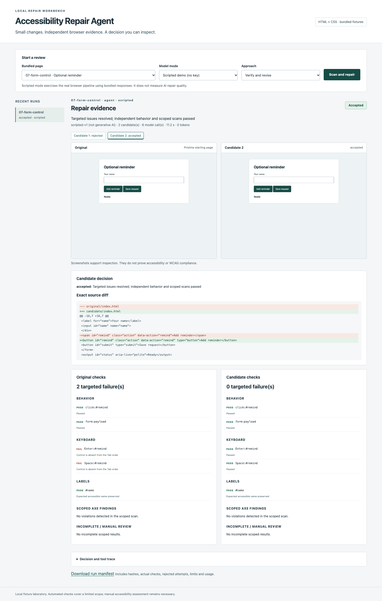
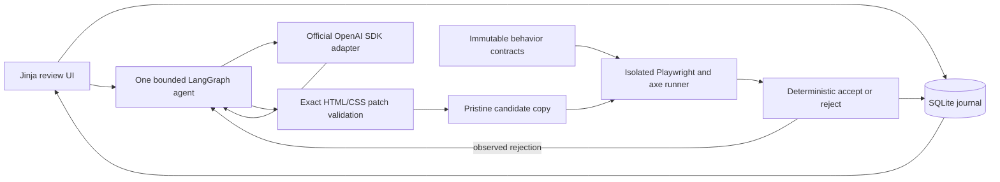

# Accessibility Repair Agent

A local workbench that proposes a small HTML/CSS accessibility repair, tests it in
Chromium, and accepts it only when the targeted issues resolve without a behavior
regression. It preserves the original, rejected candidates, screenshots, source diffs
and the checks behind each decision.



## Run it

Install [uv](https://docs.astral.sh/uv/getting-started/installation/) and Node 22 LTS
(22.12 or newer). The checked-in `.nvmrc` selects the tested 22.22.2 release.
Python 3.12 is required; uv selects or installs it.

```sh
git clone https://github.com/AntarangSharma/accessibility-repair-agent.git
cd accessibility-repair-agent
nvm install
nvm use
make setup
make demo
```

Open **http://127.0.0.1:8765**. Choose `07-form-control`, keep **Scripted demo (no key)**
and **Verify and revise**, then click **Scan and repair**. The scripted mode uses bundled
model responses and the actual patch, browser and acceptance pipeline. It requires no
API key and is not evidence of generative repair quality.

On Linux, install Chromium system libraries with
`npx --no-install playwright install-deps chromium` if they are missing. Run commands
from this checkout; this is not a standalone pip-installed application. First setup
needs network access for dependencies and Chromium. Later scripted runs stay local.

## A real repair example

The `07-form-control` fixture contains a span with an existing click listener inside a
form. The first scripted candidate changes it to a button but omits `type="button"`.
Real browser checks reject it because clicks and keyboard activation submit the form
unexpectedly. The revised candidate is accepted:

```diff
-<span id="remind" class="action" data-action="remind">Add reminder</span>
+<button id="remind" class="action" data-action="remind" type="button">Add reminder</button>
```

The existing ID, class, data attribute and click listener remain intact. Enter and Space
each activate it once without submitting the form. An independent submission test still
receives `{"name": "River"}`. Pointer and keyboard action tests also assert that
entered form values survive activation, catching accidental reset buttons. The interface lets you open both attempts and inspect the
actual checks. `01-newsletter` provides a smaller label-repair example.

## Supported scope

Exactly three repair categories are supported:

- Missing form labels when surrounding text unambiguously supports the intended label.
- Inadequate contrast for solid-color text and backgrounds, using small hex-color edits.
- Simple click controls missing keyboard operation, preferring native buttons and
  preserving selectors, listeners, form behavior and control dimensions.

Ambiguous labels, gradients, image backgrounds, complex widgets and framework
applications require manual review. The app accepts only bundled fixture identifiers.
It has no arbitrary URL, repository download, JavaScript upload or command input.
Automated checks and screenshots do **not** establish WCAG compliance.

## How it works



The model chooses `inspect_page`, `read_source`, `propose_patch`, or `verify_candidate`.
The coordinator initially scans the original to avoid unnecessary edits and reject
unsupported cases. Inspection returns actual cached browser evidence. Every candidate
starts from the original, with at most three attempts and 12 model calls. Strict hashes,
exact matches and structural validation bound each edit. Only the application can accept
a candidate; the model cannot edit scripts, contracts, tests or validators.

The browser runner has a versioned JSON contract and fixed subprocess argv. Its separate
localhost fixture server, allowlisted requests and CSP isolate previews from application
controls. It starts a fresh browser context for each candidate. Acceptance combines
scoped axe scans, accessible-name checks, explicit Tab/Enter/Space tests, immutable click
and form payload assertions, visibility checks and control dimension tolerances.
Restart recovery discards unverified active work while retaining review evidence.

## Measured results

The [measured results](docs/results.md) and committed [scripted report](reports/scripted.json) contains actual Chromium/axe
results, hashes, timing, usage and every rejected attempt for all **36 runs**: two
approaches on 18 pages. Six template families were reserved before repair logic was
built. Development and reserved results are separate below.

| Scripted approach | Development repairs | Reserved-family repairs | Total repairs | Accepted behavior regressions | Edits to correct pages | Correct unsupported abstentions |
| --- | --- | --- | --- | --- | --- | --- |
| Single-shot | 6/8 | 4/4 | 10/12 | 0/10 | 0/3 | 3/3 |
| Verify and revise | 8/8 | 4/4 | 12/12 | 0/12 | 0/3 | 3/3 |

Single-shot makes 12 candidate attempts; the bounded agent makes 14. Both encounter one
candidate with a behavior regression and reject it. Tokens and API spend are zero in
scripted mode. Per-split total/median latency is recorded in the report and depends on
the host. The deliberately bad first scripted responses explain this comparison; it
cannot establish a live model advantage or held-out generalization.

**Live evaluation is pending:** no `OPENAI_API_KEY` was available during delivery.
[Live evaluation status](reports/live.json) and [smoke status](reports/live-smoke.json)
record that no API calls were made. The target of at least 10/12 verified live repairs
is unmeasured. No live repair rate, token count or latency is claimed.

## Commands and live mode

| Command | What it does |
| --- | --- |
| `make setup` | Installs frozen Python/Node dependencies and Chromium. |
| `make demo` | Starts the local application on 127.0.0.1:8765. |
| `make test` | Runs unit tests, real browser integration tests and an actual UI journey. |
| `make check` | Checks Python/Jinja/JS/CSS formatting, lint, strict Python types and forbidden characters. |
| `make eval-fixtures` | Runs both scripted approaches on all 18 clean fixture copies. |
| `make smoke-live` | Runs both live approaches on one page, with a $0.30 aggregate estimate cap. |
| `make eval-live` | Runs both live approaches on all 18 pages, with a $3 aggregate estimate cap. |
| `make docker-smoke` | Builds the browser-capable image, runs its tests, then its real UI journey. |

Configure `OPENAI_API_KEY` in your local shell or secret manager, then restart `make demo`
or run the live commands. Never put a key in source, an issue or chat. The app does not
automatically load `.env`. Without a key, live commands write an explicit pending report
and exit with code 2. All deterministic commands work without API secrets.

The default model is `gpt-6-luna` with low reasoning effort and standard service. To use
another model, configure `OPENAI_MODEL`, `OPENAI_INPUT_USD_PER_MILLION` and
`OPENAI_OUTPUT_USD_PER_MILLION` together. The default estimate uses a conservative
$0.25/M input allowance and $0.50/M output rate. Costs are estimates rather than a billing
guarantee. Each run is capped at three candidates, 12 calls, 2,200 output tokens per call,
24,000 input bytes per call, 180 seconds, zero SDK retries and $0.30 estimated spend.
The CLI can tighten aggregate spend with `--budget-usd`. Failed requests retain a spend
reservation. See [engineering notes](docs/engineering.md) for exact boundaries.

## Verification and evidence

The tests cover traversal, stale hashes, symlink escape, script changes, missing and
ambiguous matches, attempt/call/time/spend limits, rollback, restart recovery, correct-page
no-ops and unsupported abstention. A real integration test fixes axe findings but breaks
form submission, proving that a cleaner axe report cannot override functional checks.
The SDK contract test uses the real locked SDK with an isolated mock HTTP transport.
CI runs deterministic tests, browser integrations, a real UI journey, fixture evaluation
and container tests without API secrets.

State stays in ignored `.state/`. Each run includes a pristine original, per-candidate
files and screenshots, an fsynced `run.json`, dependency and fixture hashes, implementation
hashes, concise decisions and actual tool results. Rejected candidates are never promoted.
The app serves images and escaped diffs, not executable candidate previews.

The Docker image also binds its UI to localhost inside the container. `make docker-smoke`
tests it internally; publishing a container port alone does not expose that listener.

Read [the three-minute demo](docs/demo.md), [engineering decisions and interview answers](docs/engineering.md),
[the JSON boundary](docs/browser-contract.md) and [sources and usage terms](docs/sources.md).
Fixtures use original self-contained markup informed by W3C WAI, GDS and Playwright
patterns, with attribution. This project was built with AI assistance. Claims are limited
to measured runs; live quality, screen-reader usability, general-site repair and full
accessibility conformance remain unproven.
